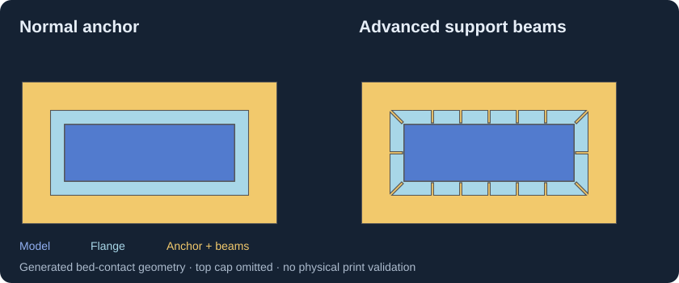
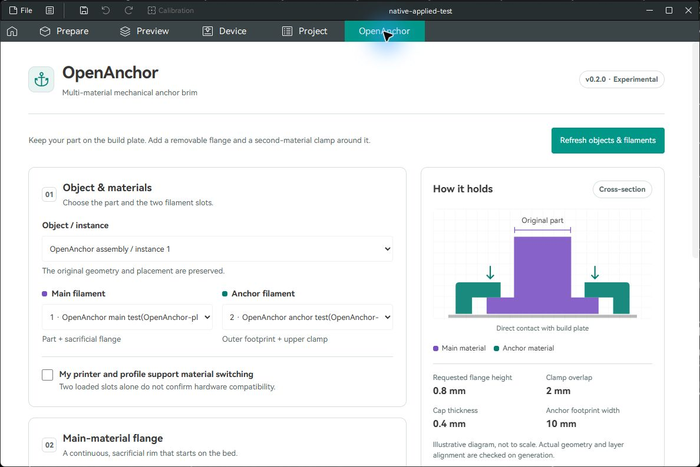
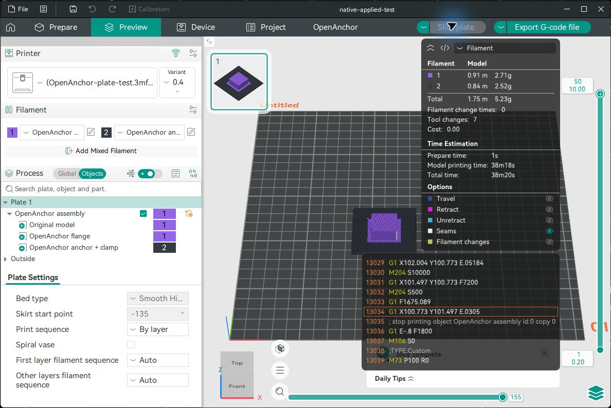

# OpenAnchor

**Multi-material mechanical anchor brims for OrcaSlicer.**

[](https://github.com/Nikotina0001/OpenAnchor/releases/tag/v0.2.0-beta.1)
[](https://github.com/Nikotina0001/OpenAnchor/actions/workflows/tests.yml)
[](LICENSE)

[Download Beta 1](https://github.com/Nikotina0001/OpenAnchor/releases/tag/v0.2.0-beta.1) · [Installation](docs/INSTALLATION.md) · [Usage](docs/USAGE.md) · [Report a bug](https://github.com/Nikotina0001/OpenAnchor/issues/new/choose)

OpenAnchor generates a sacrificial flange and a separate, second-material anchor around a model. The anchor contacts the bed and overlaps the flange from above. An optional advanced mode adds bed-to-cap support beams through matching flange slots. Your original model mesh is preserved.

> **Public beta:** geometry and offline slicing have been checked; adhesion, removal and warpage performance have not been physically validated. Begin with a small calibration specimen and review the sliced result before printing. This is an independent community project, not an official OrcaSlicer plugin.



*Generated calibration geometry, viewed from the bed. The top cap is omitted so the beams and slots are visible. This is a geometry illustration, not a print result.*

## Inside OrcaSlicer



*Actual native OpenAnchor tab from the earlier 0.2 development build. Beta 1 adds the gap, reset/check and advanced-beam controls described below; the screenshot is retained as a host-integration example.*

<details>
<summary>See the actual two-material OrcaSlicer Preview</summary>



*Actual isolated normal-anchor calibration test: original model, flange and anchor remain separate assigned parts. Synthetic offline profile; this is an earlier native Preview capture, not a Beta 1 advanced-mode check or a physical print.*

</details>

## What it does

- Adapts the flange and anchor to the lower model geometry, including sloped walls and low overhangs.
- Keeps the source mesh and its placement intact.
- Offers normal anchors and optional advanced support beams along contours and corners.
- Stops beam searches at intervening model-clearance regions to avoid distant stray fragments.
- Provides Reset, Check settings and geometry-verified suggestions.
- Checks bed boundaries, supplied exclusions, nearby objects, solid validity and material intersections.
- Exports an aligned, three-part 3MF with material assignments and **100 flange wall loops**.
- Enables **Apply to plate**, **Update anchor** and **Restore original** when the optional native bridge is present.

## Compatibility

| Environment | Status / workflow |
| --- | --- |
| Windows x64, OrcaSlicer 2.5.0-beta revision `345efec6` | Development environment tested; install the wheel and use Export 3MF. |
| OpenAnchor-enabled build of that revision | Direct Apply / Update / Restore available through the included bridge patches. |
| Other Orca builds with the Python Pages plugin API | Compatibility unverified; APIs and dependency availability may differ. |
| Orca builds without Python plugin support | Cannot load the plugin. The standalone Python CLI is available. |
| Linux / macOS | Geometry tests run in Linux CI; embedded plugin and native bridge behavior are unverified on these systems. |

**The downloadable plugin does not modify or replace OrcaSlicer.** Direct plate editing requires a separately compiled OpenAnchor-enabled application. Beta 1 includes its [source patches and build notes](native/README.md), not a prebuilt custom slicer. Export/import is the supported fallback for the audited stock build.

## Install in OrcaSlicer

1. Download **`openanchor-0.2.0b1-py3-none-any.whl`** from [Beta 1 Assets](https://github.com/Nikotina0001/OpenAnchor/releases/tag/v0.2.0-beta.1). Keep the file as `.whl`; do not unzip it. GitHub's automatic source ZIP is for developers.
2. In a compatible OrcaSlicer build, open **Plugins**, then **Browse plugins → Install local plugin**. Menu placement varies by build.
3. Select the wheel. Allow OrcaSlicer to install the declared Python dependencies, enable the **OpenAnchor** Pages capability, and restart OrcaSlicer.
4. Open the **OpenAnchor** tab. Configure your actual printer and two filament slots, load a model, and click Refresh.

See [installation and troubleshooting](docs/INSTALLATION.md). GitHub publication does not add the plugin to the OrcaCloud Plugin Hub.

## First use

1. Start with a single, unpainted model part on the bed. Use a printer/profile capable of switching the two selected materials.
2. Select the object and material slots in OpenAnchor. Confirm the hardware setup.
3. Set dimensions, then click **Check settings**. Suggestions are offered only after they pass geometry checks; they do not establish physical material compatibility.
4. Use **Export 3MF** and import it **as one assembly**, or use **Apply to plate** in an OpenAnchor-enabled build.
5. Slice and inspect the first layers, cap transition, filament assignments, tool changes and wipe-tower clearance in Preview.

With direct Apply, select **OpenAnchor flange** and set **Wall loops = 100** manually. The current bridge cannot set this override; exported 3MF files include it automatically.

### Defaults

| Setting | Default |
| --- | --- |
| Flange-to-object gap | 0.1 mm |
| Flange-to-anchor / beam-slot gap | 0 mm nominal |
| Advanced support beams | Off |
| Beam width / spacing / model clearance | 0.8 / 10 / 0.6 mm |
| Flange wall loops in exported 3MF | 100 |

Nominal zero interfaces use a small coordinate-dependent fitting tolerance, recorded in the generation report. A positive flange-to-object gap separates the model from the flange and can reduce retention.

## Beta limitations

- No verified physical material pairing or measured warpage improvement.
- Painted models, unknown multipart objects and modifiers are rejected. Direct editing requires one instance.
- CLI input is STL/OBJ in millimetres, with planar bed contact at Z=0; arbitrary 3MF input is not supported by the CLI.
- Adaptive layers require the actual resolved layer-top list; automatic acquisition is unavailable in the audited API.
- Check wipe-tower placement, travel and toolhead clearance yourself. Generation is synchronous and may pause on complex meshes.
- Save/reopen can change native IDs. Keep the pre-apply project backup; unknown ownership is rejected rather than guessed.

See [verification and known limits](docs/VERIFICATION.md) for the distinction between automated, native and physical checks.

## Develop and contribute

Python 3.12 or newer is required. From a checkout:

```powershell
python -m venv .venv
.\.venv\Scripts\python.exe -m pip install -e '.[test]'
.\.venv\Scripts\python.exe -m pytest -q
.\.venv\Scripts\python.exe -m build
```

[Developer guide](docs/DEVELOPMENT.md) · [Contributing](CONTRIBUTING.md) · [Changelog](CHANGELOG.md)

## License and acknowledgements

[AGPL-3.0-or-later](LICENSE). Dependency notices are listed in [THIRD_PARTY.md](THIRD_PARTY.md). OrcaSlicer and its contributors provide the host plugin API; the optional native patches target the pinned upstream revision. OrcaSlicer names belong to their respective owners. Personal test models, printer profiles and third-party reference images are not included in this release.
